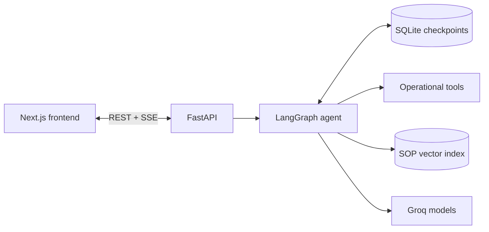

# Where Did It Go?

## Built for DAIM Agentic AI Summer Bootcamp
> more info https://jsmboli.github.io/agentic-ai-bootcamp/

**An agentic investigator for fulfillment exceptions.** When a warehouse pick fails, it works out
*why*, shows the evidence, recommends what to do next, and hands consequential decisions to a human.


> Prototype built on synthetic data. It recommends; a person decides. See [Limitations](#limitations).

## What it does

A pick task fails and the cause is buried across order records, task history, inventory state,
scan events and written procedure. This project turns that into one investigation:

1. **Opens the incident** and queries operational tools (order, pick task, inventory, location
   history, task events).
2. **Checks procedure** by searching a library of SOPs by meaning, not keyword.
3. **Traces the item** deterministically: replays its scan events to find where the records last
   place it, and whether that explains each failed pick.
4. **States a finding**, worded as an inference rather than a fact, with every claim tied to numbered
   evidence (operational or procedural, supporting or conflicting).
5. **Pauses for a human** when evidence conflicts, the item is restricted or high-value, procedure
   demands confirmation, or the evidence is too thin. The reviewer can approve, reject, ask for
   more investigation, modify, or escalate.

The landing page walks through one missing item as a scroll story: a unit is put away, moves
without a scan, a pick fails, the agent traces it, and a human signs off.

## Why it's useful

- **Evidence over guesses.** Findings cite their evidence, and "I can't establish a cause" is a
  valid, tested outcome when records don't exist.
- **Human authority is built in.** Review triggers are explicit rules you can read in code, not
  model mood. A restricted SKU can never resolve without a recorded human decision.
- **Durable and auditable.** State is checkpointed to SQLite, so a review can wait for minutes or
  survive a restart, and every graph step is available as an audit trail with JSON export.
- **Tested for behavior.** Five evaluation cases (normal, edge, failure, evidence, high-risk) check
  what the agent does, not just what it says. See [Evaluation](docs/EVALUATION.md).

## Getting started

### Prerequisites

- Python 3.11
- Node.js 20.9 or newer
- A free [Groq API key](https://console.groq.com). Nothing else needs a key: retrieval uses a local
  embedding model, downloaded (~80 MB) the first time the backend starts.

### Run it

```bash
# Backend: http://localhost:8000
cd backend
python3 -m venv .venv && source .venv/bin/activate
pip install -r requirements.txt
cp .env.example .env        # then set GROQ_API_KEY in .env
./run.sh
```

```bash
# Frontend (second terminal): http://localhost:3000
cd frontend
npm install
npm run dev
```

Open <http://localhost:3000>, choose **Open the investigation console**, pick an incident, and
start an investigation.

### Try the demo incidents

Five synthetic incidents ship with the app, each built to exercise one behavior:

| Incident | Category | What happens |
|---|---|---|
| `INC-1042` | Evidence | Inventory says A-17, scan history says B-12. Review is required; tell the agent to "check if it moved" and it re-investigates. [Walkthrough](docs/DEMO_SCRIPT.md) |
| `INC-2091` | Normal | A confirmed stockout resolves without needless review. |
| `INC-3157` | Edge | A legitimate short pick on an expedited order; procedure requires human confirmation. |
| `INC-4400` | Failure | No inventory record and no scan history; the agent must say it can't establish a cause. |
| `INC-5210` | High-risk | Clean evidence, but a restricted SKU forces review on authority grounds. |

You can also file your own at `/investigations/new`; user incidents are stored separately and never
affect evaluation results.

### Use the API directly

```bash
curl localhost:8000/api/health                     # {"status":"ok"}
curl localhost:8000/api/incidents                  # list incidents
curl localhost:8000/api/incidents/INC-1042/trace   # deterministic item trace, no LLM call

# Stream an investigation as Server-Sent Events
curl -N -X POST localhost:8000/api/incidents/INC-1042/investigate
```

Other routes: `POST /api/incidents`, `GET /api/incidents/{id}`, `GET /api/incidents/{id}/audit`,
`POST /api/incidents/{id}/review`. They are defined in
[`backend/app/api/routes.py`](backend/app/api/routes.py).

### Run the checks

```bash
cd backend && source .venv/bin/activate

python -m eval.check_trace           # item trace, no API key needed
python -m eval.check_procedures      # forced procedure search, no API key needed
python -m eval.run_retrieval_eval    # SOP retrieval accuracy, no API key needed
python -m eval.run_eval              # full agent evaluation, needs GROQ_API_KEY
```

The full evaluation writes `backend/eval/last_run_report.md`. It makes real model calls, and
Groq's free tier is rate-limited, so expect retries (see [Limitations](#limitations)).

### Configuration

Set in `backend/.env`; only the key is required.

| Variable | Default | Purpose |
|---|---|---|
| `GROQ_API_KEY` | none | Groq access |
| `FAST_MODEL` | `openai/gpt-oss-20b` | Risk and sufficiency judgment |
| `CAPABLE_MODEL` | `openai/gpt-oss-120b` | Tool-calling investigation and synthesis |
| `MAX_INVESTIGATION_ROUNDS` | `3` | Rounds before forced escalation |
| `MAX_TOOL_CALLS_PER_ROUND` | `5` | Tool-call budget per round |

## How it works



The agent is a LangGraph state machine: `intake`, a bounded `investigate ⇄ tools` loop, a
guaranteed `procedures` search, `synthesize`, `assess`, then `human_review` (a real
`interrupt()`), and finally `finalize` or `escalate`. Tools return raw data only; judgment happens
once, in `synthesize`, and risk rules are plain code wherever possible.

The design rationale, the full graph, tool table, RAG, model routing and evaluation history are in
[docs/ARCHITECTURE.md](docs/ARCHITECTURE.md).

## Project structure

```
backend/
  app/
    nodes/       graph steps: intake, investigate, tools, procedures, synthesize, assess, ...
    tools/       operational tools and procedure search
    rag/         SOP corpus (Markdown) and the Chroma index
    api/         REST + SSE routes
    data/        synthetic fixtures (orders, pick tasks, inventory, scan events)
    trace.py     deterministic item trace
  eval/          evaluation suite and offline checks
frontend/
  app/           landing page, incident list, investigation workspace
  components/    hero (3D + scroll story), investigation panels, UI primitives
docs/            architecture, evaluation, failure modes, demo script
```

## Documentation

| Doc | Contents |
|---|---|
| [Architecture & design notes](docs/ARCHITECTURE.md) | Graph, tools, RAG, state, model routing, human review, limitations, next steps |
| [Evaluation](docs/EVALUATION.md) | The five cases, how scoring works, run history |
| [Failure modes](docs/FAILURE_MODES.md) | How each failure is detected and handled |
| [Demo script](docs/DEMO_SCRIPT.md) | A guided walkthrough of `INC-1042` |

## Limitations

- **Synthetic data, narrow scope.** Five incidents hand-built for evaluation, covering pick-task
  exceptions only. Real warehouse data is messier.
- **Small procedure library.** Seven SOPs; retrieval on a larger, noisier corpus is untested.
- **Groq free-tier limits.** Per-minute limits are retried automatically; the daily token cap is
  not recoverable. If the app or the evaluation fails with a "tokens per day" error, wait for the
  reset or use a paid tier.
- **WebGL fallback.** The hero uses WebGL where it is stable and falls back to a CSS 3D version
  otherwise.
- **Human review is required by design** for every consequential decision.

## Getting help

- Check the [failure modes](docs/FAILURE_MODES.md) and [architecture notes](docs/ARCHITECTURE.md)
  first; most "why did it do that?" questions are answered there.
- Open an issue on the
  [issue tracker](https://github.com/AbdulRahman1807/Where-Did-It-Go-/issues) with the incident ID,
  what you expected, and the backend log output.

## Maintainers and contributing

This project is developed by its contributors; see the
[commit history](https://github.com/AbdulRahman1807/Where-Did-It-Go-/commits/main) for who has
worked on it.

To contribute:

1. Fork the repository and create a branch.
2. Run the offline checks above, plus `npm run lint` and `npx tsc --noEmit` in `frontend/`.
3. If you change agent behavior, re-run `python -m eval.run_eval` and note the result.
4. Open a pull request describing what changed and why.

There is no `LICENSE` file in the repository yet. Add one before reusing or redistributing the
code.
