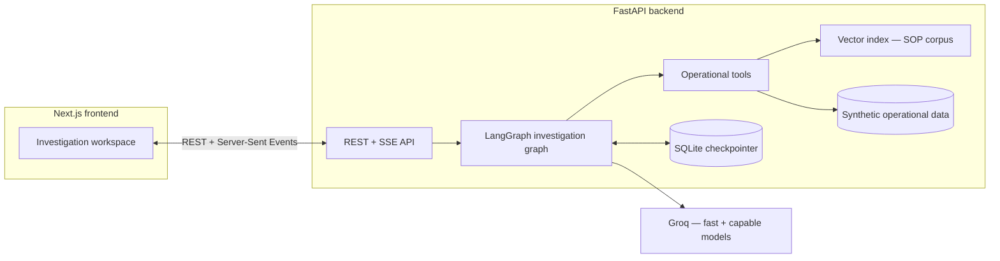
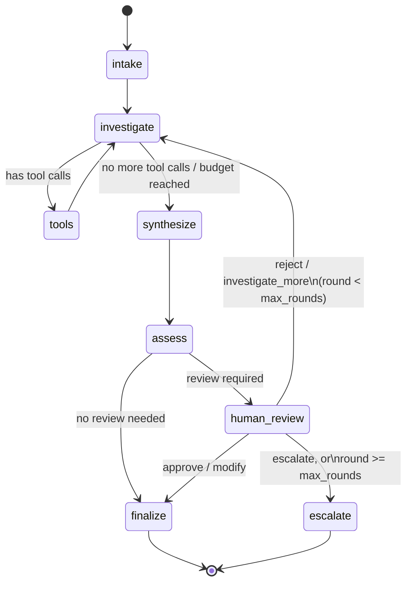

# Where Did It Go?

**An Agentic Fulfillment Exception Investigator**

> The system investigates fulfillment exceptions using operational evidence and documented
> procedures, produces a recommendation, and routes consequential decisions to a human reviewer.

This is an overnight capstone prototype. It is not production-ready — see [Limitations](#limitations)
for what that means concretely. It was built against a written product and frontend design spec
(kept out of this repo); this document explains what was actually built against it, and the
`Master Spec section N` references throughout the source comments point back at that spec.

---

## 1. Problem statement & agent goal

When an automated pick task fails, the hard part usually isn't the failure itself — it's figuring
out *why*, whether the available evidence actually supports a given explanation, what procedure
applies, and what should happen next. That evidence is scattered across order records, task
history, inventory state, location/scan events, and written procedure.

The agent's job: **investigate a pick exception, gather relevant operational and procedural
evidence, determine the most plausible explanation the evidence actually supports, recommend a
next action, and escalate to a human whenever the evidence, risk, or authority boundary requires
human judgment.** It is an investigation and decision-support agent, not an autonomous warehouse
controller — it recommends, a human decides.

## 2. Quickstart

Two services: a Python/FastAPI backend running the LangGraph investigation agent, and a Next.js
frontend.

```bash
# Backend
cd backend
python3 -m venv .venv && source .venv/bin/activate
pip install -r requirements.txt
cp .env.example .env   # then put your GROQ_API_KEY in .env
./run.sh                # http://localhost:8000

# Frontend (separate terminal)
cd frontend
npm install
npm run dev              # http://localhost:3000
```

Get a free Groq API key at [console.groq.com](https://console.groq.com). Nothing else needs a key —
retrieval uses a local embedding model (see [section 6](#6-rag--knowledge-grounding)).

To run the evaluation set: `cd backend && source .venv/bin/activate && python -m eval.run_eval`
(writes `backend/eval/last_run_report.md`).

## 3. Architecture

Two services, one shared contract (`backend/app/state.py` ↔ `frontend/lib/types.ts`).



**Why two services, not one.** The agent (state machine, tool calling, retrieval, LLM calls) is
naturally a Python/LangGraph problem; the cinematic, highly interactive frontend is naturally a
Next.js/React problem. Keeping them as two plain services with a small typed HTTP contract is easier
for a team to reason about than forcing one language to do both jobs.

**Why SSE, not WebSockets.** The frontend only needs to *receive* a stream of progress events during
an investigation or review — it never needs to push arbitrary messages back mid-stream. A one-way
stream over a plain POST response is simpler to implement, simpler to explain, and has no separate
protocol to reason about.

## 4. Agent workflow (LangGraph)



- **intake** — deterministic. Initializes state from the incident record. No model call: which
  order/task an incident refers to is a lookup, not a judgment call.
- **investigate ⇄ tools** — a bounded ReAct loop (capped at `MAX_TOOL_CALLS_PER_ROUND`, default 5).
  The capable model decides which operational tools or the procedure-search tool to call next,
  given what's already been found.
- **synthesize** — the capable model turns the round's raw tool transcript into a structured case
  file: evidence (each tagged operational/procedural and supports/conflicts/neutral), a finding
  (explicitly worded as an inference), a recommendation, and any unresolved questions.
- **assess** — risk/review decision. Deliberately hybrid: plain-code rules catch the unambiguous
  cases (conflicting evidence, a restricted/high-value SKU, an expedited short-pick), and only the
  genuinely soft judgment — *is this evidence actually sufficient* — goes to a model call. See
  `backend/app/nodes/assess.py`.
- **human_review** — the real interruption point, via LangGraph's `interrupt()`. The graph is
  checkpointed to SQLite, so this is a genuine pause: the process can restart, another HTTP request
  can arrive minutes later, and `Command(resume=...)` picks the exact node back up.
- **Round cap** — `MAX_INVESTIGATION_ROUNDS` (default 3). A reject/investigate-more decision that
  would exceed it forces an escalation instead of another loop — the safeguard against an
  uncontrolled investigation loop that Master Spec section 8 requires.

This graph was smoke-tested end-to-end with fake models (interrupt → resume → approve, and the
reject-loop → round-cap → forced-escalation path) before any real LLM calls were made, specifically
to validate the state machine plumbing independent of model quality.

## 5. Tools

| Tool | Source | Returns |
|---|---|---|
| `get_order_info` | Order records | Status, priority, line items |
| `get_pick_task` | Pick task records | Assigned location, requested qty, attempt history |
| `get_inventory_record` | Inventory records | Qty on hand, last updated/cycle-counted |
| `get_location_history` | Location/scan events | Chronological putaway/pick/move/count events for a SKU |
| `get_task_event_history` | Task event log | System-generated events (creation, auto-escalation, etc.) |
| `search_procedures` | Vector index over the SOP corpus | Top-k relevant procedure sections |

Tools return raw data only — they don't classify or interpret it ("this is a conflict"). That
judgment happens once, explicitly, in `synthesize`, which keeps the tools themselves simple and
auditable and avoids scattering judgment calls across the codebase.

### Where the operational data comes from

All of it is fabricated, on purpose — not a shortcut, an explicit requirement (Master Spec section
18: a synthetic environment "is acceptable and preferable for the capstone" with data "deliberately
containing discrepancies for edge/failure/high-risk evaluation cases"). The five eval-mapped
incidents (`backend/app/data/fixtures/incidents.json` + the matching orders/pick-tasks/inventory/
event records) were each hand-engineered to test something specific — e.g. INC-1042's inventory
record and its location-scan history disagree *on purpose*, timed so the agent has to actually
reconcile them rather than getting lucky. There's no real-world dataset that fits this need: WMS
pick-exception event logs are proprietary operational data companies don't publish, and even if one
existed, it wouldn't have known ground truth to check the agent's behavior against — which is the
entire point of the eval suite. Public e-commerce datasets (Olist, DataCo, Instacart) exist at the
order level, not the pick-task/location/inventory-event granularity this app investigates.

**Filing a new incident**: `POST /api/incidents` (form at `/investigations/new`) builds a
consistent order, pick task, optional inventory record, and event history from user input, and
appends it to `backend/app/data/fixtures/user_incidents.json` — loaded alongside, never merged into,
the five curated eval fixtures, so filing test incidents can never affect eval results. Leaving the
inventory-quantity field blank files it with no inventory record at all (the same "no data" shape as
INC-4400) rather than assuming a default.

## 6. RAG / knowledge-grounding

Seven short SOP documents (`backend/app/rag/corpus/*.md`) covering pick-exception investigation,
inventory discrepancies, repeated-failure/location verification, location/scan event
interpretation, escalation policy, restricted/high-value item authority, and short-pick ambiguity.

Each document is split into sections on its `## ` headings, embedded with Chroma's built-in local
embedding model (a small ONNX sentence-transformer — no external API key, no network call at query
time), and stored in a persistent Chroma collection. `search_procedures` runs a real semantic
similarity query — e.g. querying "item was moved recently before a failed pick" surfaces SOP-03's
"Required steps" section on repeated failures, without either term appearing verbatim in the query.

The point isn't that RAG exists — it's that retrieval measurably changes the outcome: the flagship
incident (INC-1042, see below) is only correctly explained once the agent retrieves and applies
SOP-03/SOP-04's guidance on how to weigh a `moved` event against a stale inventory record.

## 7. Memory / state — how it differs from RAG

RAG answers *"what does the operational knowledge base say?"* Investigation state
(`backend/app/state.py`) answers *"what has happened during this investigation?"* — the original
incident, accumulated evidence, the current finding/recommendation, risk/review status, the round
counter, and the full history of human feedback across rounds. Retrieved procedure text is written
*into* state as an evidence item like any other — never treated as a separate channel — which is
what keeps the two concerns from blurring together in the code.

State is checkpointed to SQLite per incident (`thread_id == incident_id`), which is also what makes
the human-review pause durable across process restarts and separate HTTP requests.

## 8. Provider / model routing

Two Groq-hosted models, chosen for the job, not the vendor:

- **Fast model** (`openai/gpt-oss-20b` by default) — intake-adjacent structured classification:
  the risk/sufficiency judgment in `assess`.
- **Capable model** (`openai/gpt-oss-120b` by default) — the investigation tool-calling loop and
  evidence synthesis, where multi-step reasoning over several evidence sources actually matters.
  (Groq's hosted-model catalog changes over time — `backend/app/config.py`'s `FAST_MODEL`/
  `CAPABLE_MODEL` are the source of truth if these have since been swapped for something newer.)

Routing lives in one place (`backend/app/models/llm.py`) and is a latency/cost-vs-reasoning-depth
trade-off, not a demonstration for its own sake — most of the risk/review logic is plain code
specifically so the one remaining model call is doing real work (see `backend/app/nodes/assess.py`'s
module docstring for the full reasoning).

## 9. Human review

Triggered by explicit, inspectable conditions — never arbitrarily:

| Condition | Example incident |
|---|---|
| Conflicting operational records | INC-1042 — inventory says A-17, scan history says B-12 |
| Restricted/high-value SKU (authority boundary, independent of evidence clarity) | INC-5210 |
| Procedure requires confirmation regardless of evidence (short pick, expedited order) | INC-3157 |
| Evidence judged insufficient to support a confident recommendation | INC-4400 |

The reviewer sees *why* review was required (not just that it was), the finding, the full evidence
list with support/conflict stance, and the recommendation — then chooses **Approve**, **Reject**,
**Investigate more**, **Modify**, or **Escalate**. Reject/Investigate-more feed the reviewer's
feedback text back into state as `investigation_focus` and start a new round; Modify overwrites the
recommendation with the reviewer's text; Escalate and the round-cap safeguard both terminate with an
explained escalation rather than a forced conclusion.

## 10. Evaluation

Five cases, one per required category, each pointed at a purpose-built synthetic incident. Full
detail and current results in [`docs/EVALUATION.md`](docs/EVALUATION.md); run it yourself with
`python -m eval.run_eval`.

| Case | Category | What it checks |
|---|---|---|
| INC-1042 | Evidence | RAG retrieval + conflict detection materially change the outcome; the human-feedback loop ("check if it moved") is scripted and re-investigated |
| INC-2091 | Normal | Confirmed, unconflicted stockout resolves without unnecessary review |
| INC-3157 | Edge | Ambiguous-but-legitimate short pick; review triggers for a procedural reason, not an evidence conflict |
| INC-4400 | Failure | No inventory record, no location history — the agent must say it can't establish a cause, not fabricate one |
| INC-5210 | High-risk | Clean, unconflicted evidence, but a restricted SKU forces review purely on authority grounds |

Each case checks *behavior* (was review correctly required or not, what evidence types were
retrieved, what the final status was) plus an LLM-judge pass on whether the wording honestly
reflects the evidence — not exact-answer matching. A correctly-recognized "I don't know" is a pass.

**What actually running it against live Groq calls found**, across 10 real runs during development
(full history in [`docs/EVALUATION.md`](docs/EVALUATION.md)): the structural, code-enforced checks
(did review trigger for the right reason, was the risk level and final status correct, were the
right evidence types retrieved) started out reliable and stayed that way once one gap was closed —
the LLM-judge pass caught five distinct, real wording problems over the course of development
(wrong evidence-ID citations, an invented "stale data" narrative for records that actually agreed,
under-hedged missing-evidence wording, conflating a procedural review-requirement with the
operational cause, and an evidence-stance labeling nuance), and one *structural* regression, where
softening the "no records exist" case's wording accidentally made the model's own sufficiency
judgment flip to "review not needed." That regression was closed the right way: not by re-wording
around it, but by adding a fourth **deterministic** rule to `app/nodes/assess.py` that checks the
actual tool data (zero inventory records and zero location-history events) rather than trusting an
LLM's phrasing-sensitive judgment — verified with a plain-Python unit check, independent of any live
call. The wording issues were fixed at the prompt level in `app/nodes/synthesize.py`, each verified
by a subsequent passing run, never by loosening an assertion.

**Where it landed:** the last three consecutive full runs all hit **5/5 on every structural/safety
check** and **4/5 full pass** overall (structural checks plus the judge) — including a confirmation
run after the granular tool-checkpointing rewrite, the finalize-time restricted-SKU guard, and one
added noise event (see next-steps #3, #4, #6 below), none of which needed a prompt change. The one
remaining non-pass each time was a different case, on a genuinely minor, arguably-debatable wording
point — not a repeated or unaddressed failure mode. That's consistent with sitting near the
practical ceiling for a model this size against a deliberately strict judge, not with an
outstanding bug. Re-run `python -m eval.run_eval` any time; expect occasional single-case judge
variance on wording, not structural failures.

A separate, LLM-free **retrieval evaluation** (`python -m eval.run_retrieval_eval`, no
`GROQ_API_KEY` needed) checks 17 labeled query→expected-SOP-section cases directly against the
live Chroma index — first run: 16/17, with the one miss documented and kept in deliberately as a
real, found corpus gap. See [`docs/EVALUATION.md`](docs/EVALUATION.md#retrieval-evaluation).

## 11. Failure modes

Full table in [`docs/FAILURE_MODES.md`](docs/FAILURE_MODES.md). Summary: insufficient evidence,
conflicting records, an unavailable/empty tool result, ambiguous incidents, and repeated unresolved
rounds are all explicit, designed-for cases — each has a specific detection path (a deterministic
rule, a model sufficiency judgment, or the round-cap safeguard) and a specific response (state a
finding honestly, flag for review, or escalate). None of them are handled by hoping the model
behaves.

## 12. Limitations

- **Synthetic data.** Five live incidents and two seed historical records, hand-built to exercise
  specific evidence patterns. Real fulfillment data is messier in ways this can't demonstrate.
- **Narrow exception scope.** Pick-task exceptions only, as scoped by the master spec — not
  receiving, putaway, shipping, or any other fulfillment stage.
- **Small procedural corpus.** Seven SOPs. Retrieval quality on a much larger, noisier corpus is
  untested.
- **Mid-round interruptions are recoverable, not just review pauses.** `POST /investigate` now
  detects a case stuck in `investigating`/`investigating_again` (the connection dropped, the process
  restarted, a rate limit killed the stream) and resumes it from its last checkpoint via LangGraph's
  documented `None`-input resume — rather than only supporting resume at the review `interrupt()`.
  Verified two ways: a unit test that interrupts a stream after exactly one node and confirms it
  continues without re-running intake, and live, by starting a real investigation and killing the
  backend process mid-stream — it resumed correctly and reached the review gate. The frontend detects
  this proactively (not just after a failed action) and offers "Resume investigation" the moment the
  page loads on a case left in that state. What's still not recoverable: a node killed truly
  mid-execution (between checkpoints) re-runs that one node from its last complete state, which is
  the intended behavior, not a gap.
- **Groq free-tier rate limits are real and were hit repeatedly during development**, not just a
  theoretical risk: both a per-minute cap (8,000 TPM on the capable model) and, after enough
  iteration in one day, a **daily** cap (200,000 TPD) — the latter blocks further calls until it
  resets, and no amount of backoff fixes that. `invoke_with_retry` (`app/models/llm.py`) handles the
  per-minute case with exponential backoff, which is enough for a normal investigation or a single
  eval run; it cannot do anything about the daily cap. If the live app or `eval/run_eval.py` starts
  failing with a `RateLimitError` mentioning "tokens per day," that's the daily cap, not a bug — wait
  for it to reset or use a paid tier. The API surfaces in-app failures as a generic "temporarily
  unavailable" message rather than exposing the raw provider error, per the design spec's error-
  handling rule.
- **3D degrades in two real stages, not one.** During development, WebGL was confirmed unreliable in
  at least one testing environment — traced to the root cause, not just observed: React Three
  Fiber's entire render loop is built on `requestAnimationFrame`, and that environment never fires
  rAF callbacks at all (confirmed independently of the 3D code). No WebGL context configuration can
  work around that. `Hero3DGate` (`frontend/components/hero/`) now handles this with a real second
  stage: it attempts WebGL first, but if it doesn't confirm stable within ~1.2s, it falls back to
  `ExplodedObjectCSS` — the same exploded-object concept rebuilt with plain CSS 3D transforms
  (`transform-style: preserve-3d`), driven by scroll/pointer *events* rather than a render loop, with
  the idle rotation as a native CSS `@keyframes` animation. That fallback is a fully designed second
  experience, not a blank/typography-only state. Worth knowing if a demo machine's WebGL also proves
  unreliable — the hero will still look intentional, just via the CSS path.
- **Single evaluator, small eval set.** Five cases is enough to demonstrate the required categories,
  not enough to make statistical claims about reliability.
- **Human review still required for every consequential decision** — by design, not as a gap to
  close.

## 13. Realistic next steps

Roughly in priority order:

1. **Broader exception coverage** — extend beyond pick-task exceptions once the pattern is proven.
   Not started: this is a genuinely open-ended item, not a scoped engineering task — `state.py`,
   `intake.py`'s prompt, and every operational tool are pick-task-specific by design today, and
   defining what a receiving- or putaway-exception investigation actually needs (new fixtures, new
   SOPs, possibly new tools) is a product decision the master spec doesn't currently make, not
   something to guess at unilaterally.
2. ~~**Retrieval evaluation**~~ — **done.** `backend/eval/retrieval_cases.py` +
   `eval/run_retrieval_eval.py`; see [`docs/EVALUATION.md`](docs/EVALUATION.md#retrieval-evaluation).
3. **Richer event history** — **started, not comprehensive.** Added one deliberately irrelevant
   `cycle_count` event to INC-1042's location history (`backend/app/data/fixtures/
   location_events.json`, `LOC-EVT-0093`, 2026-08-22: confirms 1 unit at A-17 four days before the
   `moved` event that actually explains the failure) — noise the agent must correctly discount
   without changing the correct answer, exactly the "distinguish signal from noise" stress test
   this item asks for. Verified against a live Groq run: the finding still correctly identifies the
   move to B-12 and flags the inventory-vs-location conflict, unaffected by the added noise. Scaling
   this across the rest of the world's event history (rather than the one flagship case) is still
   open.
4. ~~**Mid-round crash recovery**~~ — **done.** The `tools` node (`app/nodes/tools.py`) now executes
   exactly one pending tool call per graph step instead of LangGraph's prebuilt `ToolNode` running
   an entire AI turn's tool calls as one step, so a checkpoint lands after every individual call —
   a crash mid-batch now redoes at most the one in-flight call, not the whole batch, without
   changing what the model sees (still one `ToolMessage` per call, in order). Verified against a
   live Groq investigation (16 checkpoints recorded for a single round, alternating
   `investigate`/`tools` per call) and directly, without any LLM call, by driving the node/router
   functions through a synthetic 3-tool-call AI turn and confirming it loops `tools -> tools ->
   tools -> investigate` in order before handing back control.
5. ~~**Audit logging**~~ — **done.** `GET /api/incidents/{id}/audit` (`backend/app/api/service.py`'s
   `get_audit_trail`) walks the checkpointer's full `aget_state_history` for the incident's thread
   and returns it as a plain chronological list — which graph node produced each checkpoint, its
   timestamp, status/round/risk at that point, and the exact new `activity_log` lines that step
   contributed. Surfaced in the frontend as a collapsible "Audit trail" panel
   (`frontend/components/investigation/AuditTrail.tsx`) at the bottom of the investigation
   workspace, with a one-click JSON export. Verified end-to-end in a real (Playwright-driven)
   browser against a live checkpointed case: the panel renders the full node-by-node trail and the
   export triggers a real download, with zero console errors.
6. ~~**Stronger authority controls**~~ — **done, scoped to SOP-06's one authority boundary** (not a
   general-purpose policy engine). `finalize_node` (`app/nodes/finalize.py`) independently re-checks
   the SKU's restricted flag straight from the operational world — not from `state["review"]`,
   which only reflects whether *assess.py's* deterministic rule happened to run correctly — and
   structurally blocks any restricted/high-value SKU from reaching a `resolved` outcome unless a
   human decision (`approve`/`modify`) is actually on record for that thread; otherwise it forces
   an escalation instead. This holds even if the upstream review-required flag were ever wrong, so
   it's the SOP-06 case specifically that "can't be reasoned around" — other authority rules aren't
   in scope here. Verified with a plain-Python unit check (no LLM call, matching the precedent set
   by the missing-evidence deterministic rule in §10): fires for a restricted SKU with no recorded
   approval, resolves normally once an approval is recorded, and doesn't false-positive on a
   non-restricted SKU with no review at all.

## 14. Demo script

See [`docs/DEMO_SCRIPT.md`](docs/DEMO_SCRIPT.md) for the full walkthrough (INC-1042: investigate →
evidence conflict → human review → "check if it moved" → re-investigation → updated finding →
approval).

## Repository layout

```
backend/     FastAPI + LangGraph investigation agent, synthetic data, SOP corpus, eval suite
frontend/    Next.js investigation console (landing, dashboard, investigation workspace)
docs/        Evaluation results, failure-mode table, demo script
```
